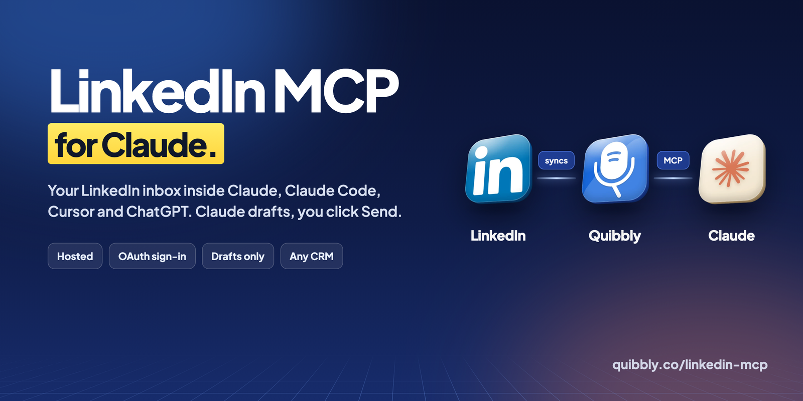
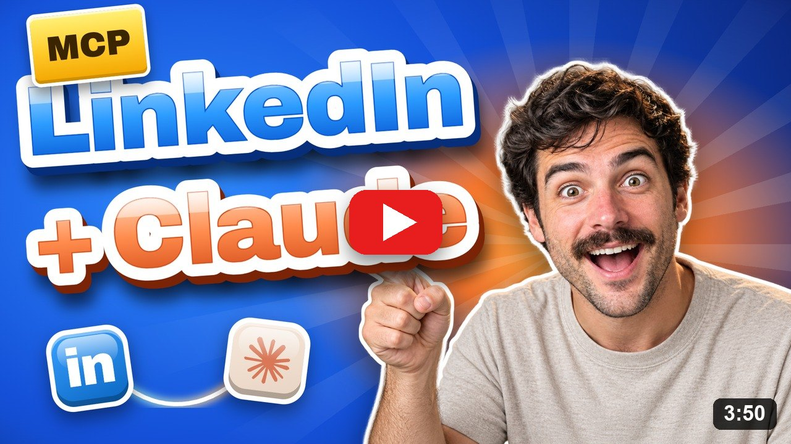
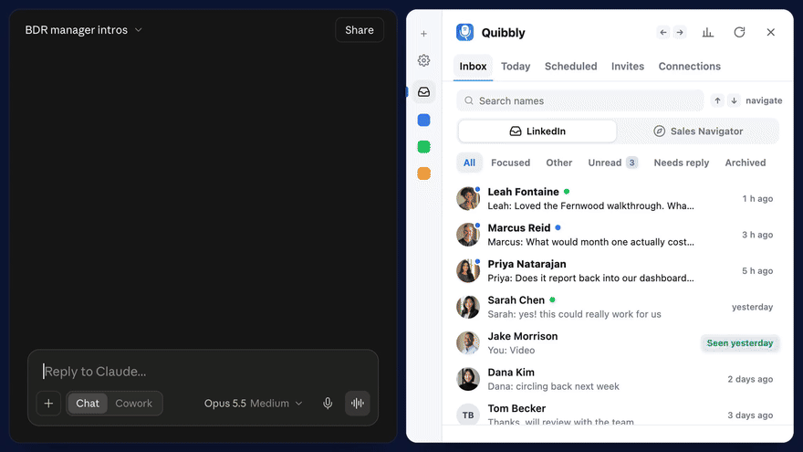
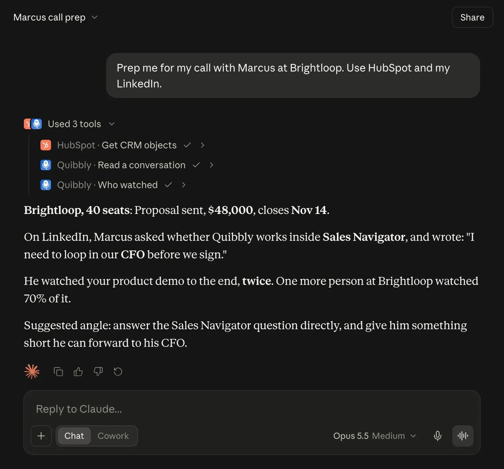
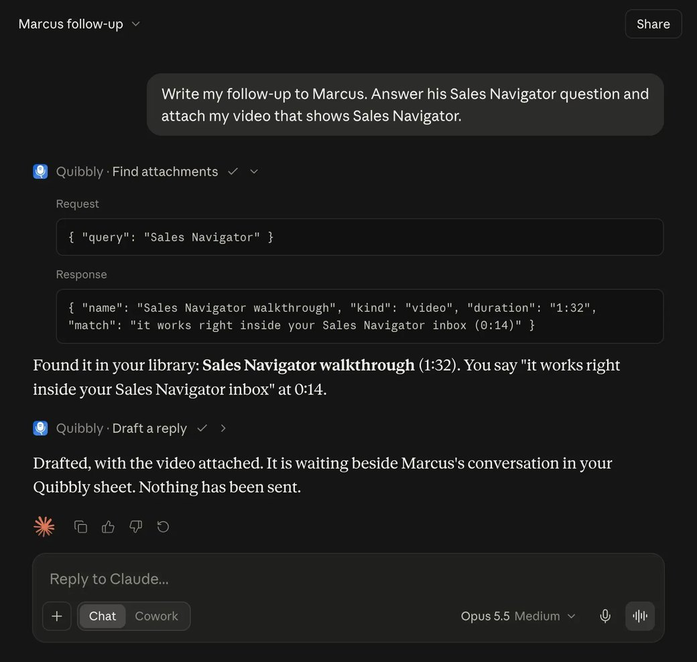
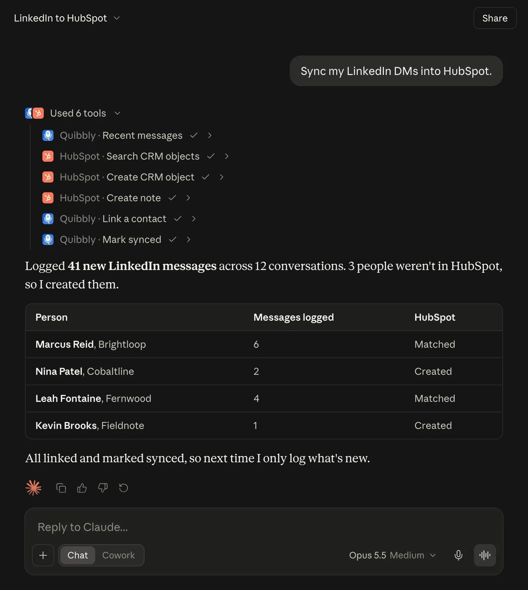
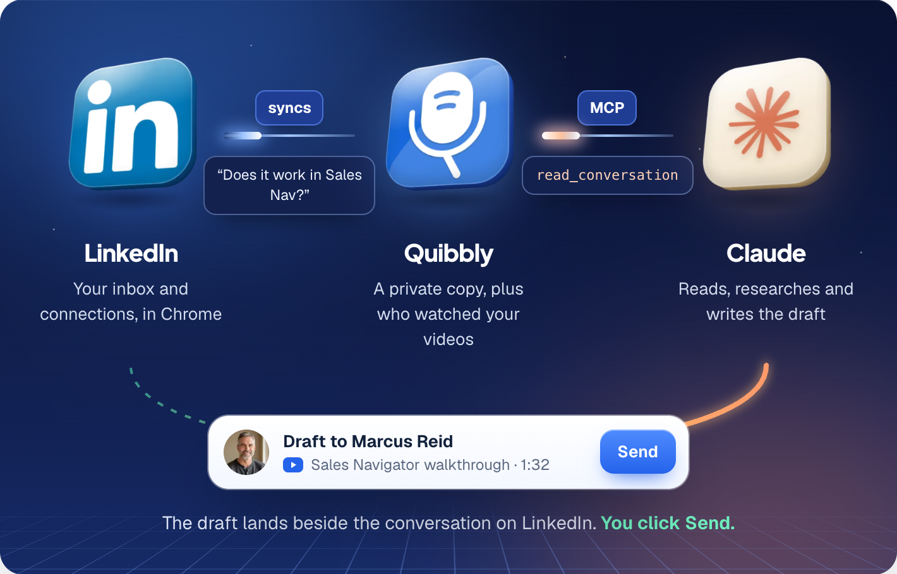

<p align="center">
  <a href="https://quibbly.co/linkedin-mcp?utm_source=github&utm_medium=readme&utm_campaign=linkedin-mcp">
    
  </a>
</p>

<p align="center">
  <a href="#quick-start"></a>
  <a href="#connect-your-assistant"></a>
  <a href="#safe-for-your-linkedin-account"></a>
  <a href="#connect-your-assistant"></a>
</p>

<p align="center">
  <b><a href="https://quibbly.co/linkedin-mcp?utm_source=github&utm_medium=readme&utm_campaign=linkedin-mcp">Read the full guide</a></b>
  &nbsp;·&nbsp;
  <b><a href="https://www.youtube.com/watch?v=xkXJ8pm3af8">Watch the walkthrough</a></b>
  &nbsp;·&nbsp;
  <a href="https://quibbly.co/docs/mcp?utm_source=github&utm_medium=readme&utm_campaign=linkedin-mcp">Docs</a>
  &nbsp;·&nbsp;
  <a href="https://quibbly.co/register?utm_source=github&utm_medium=readme&utm_campaign=linkedin-mcp">Start the 3 day trial</a>
</p>

---

The **Quibbly LinkedIn MCP server** connects your LinkedIn inbox to Claude and any other MCP client. Claude can read your conversations and connections, see who watched your videos, pull your CRM in beside them, and write messages that wait in Quibbly for you to send.

It is a hosted server, so there is nothing to install or run. You add one URL to your assistant and approve it once:

```
https://server.quibbly.co/mcp
```

## Watch the 3:50 walkthrough

<a href="https://www.youtube.com/watch?v=xkXJ8pm3af8">
  
</a>

Setup from sign-up to the first prompt, then four real examples: first messages to new connections, call prep with HubSpot, a follow-up with the right video attached, and syncing LinkedIn DMs into HubSpot.

## See it work

<p align="center">
  
</p>

One prompt in Claude, and a first message for every new BDR manager lands in the Quibbly sheet on LinkedIn, each with its own Send button. Nothing is sent until you click it.

## What you can do

**Write first messages to new connections**

```text
Write a first message to every BDR manager I connected with this month.
```

Claude searches your connections, skips anyone you have already messaged, and writes each person a message based on their role and company. Ask it to attach your intro video and every draft carries it.

**Prep a call with your CRM beside the conversation**

```text
Prep me for my call with Marcus at Brightloop. Use HubSpot and my LinkedIn.
```

With HubSpot or Salesforce connected too, Claude pulls the deal, reads the whole LinkedIn conversation and checks who watched your videos: the part your CRM never had.

<details>
<summary>See the answer</summary>
<br />

</details>

**Write the follow-up, with the right video**

```text
Write my follow-up to Marcus. Answer his Sales Navigator question and attach my video that shows Sales Navigator.
```

Claude searches what you say inside your videos, not just their titles, attaches the right one, and drafts the reply beside the conversation on LinkedIn.

<details>
<summary>See the answer</summary>
<br />

</details>

**Sync your LinkedIn DMs into HubSpot or Salesforce**

```text
Sync my LinkedIn DMs into HubSpot.
```

Claude finds every message that isn't logged yet, matches each person to their CRM contact, creates the missing ones and logs each conversation. Quibbly remembers every match and where it stopped, so the next sync only moves what is new.

<details>
<summary>See the answer</summary>
<br />

</details>

## How it works

<p align="center">
  
</p>

Claude never logs into LinkedIn. The Quibbly extension keeps a private, synced copy of your inbox while you use LinkedIn. Claude reads that copy through the MCP, and anything it writes goes back as a draft into the Quibbly sheet, right next to the conversation, where you send it yourself.

## Quick start

About five minutes, start to finish.

1. **Start Quibbly.** Sign up at [quibbly.co](https://quibbly.co/register?utm_source=github&utm_medium=readme&utm_campaign=linkedin-mcp) and pick **Solo Pro**, the plan with assistant access. The first 3 days are free; a card is needed to start, and if you cancel before the trial ends you pay nothing.
2. **Add Quibbly to Chrome** from the [Chrome Web Store](https://chromewebstore.google.com/detail/quibbly/dedfdcbmmhlabbjlofiommbngkckallc), in the Chrome profile you use for LinkedIn.
3. **Turn on Inbox.** Open LinkedIn, click the Quibbly tab on the left edge to open the sheet, and click **Turn on Inbox**. Your conversations start syncing.
4. **Connect your assistant** with the server URL below, then approve the connection on the Quibbly page that opens.

## Connect your assistant

### Claude (web, desktop and mobile)

1. Open **Customize → Connectors**, click **+ Add** and choose **Add custom connector**.
2. Name it `Quibbly` and paste `https://server.quibbly.co/mcp`, then **Add** and **Connect**.
3. Sign in to Quibbly if asked, review the permissions and click **Allow**.

Connectors you add on claude.ai also work in the Claude desktop and phone apps.

### Claude Code

```bash
claude mcp add --transport http quibbly https://server.quibbly.co/mcp
```

Then run `/mcp` in Claude Code and choose Quibbly to sign in.

### Cursor

Add it in **Settings → MCP → Add new server** (transport HTTP), or put this in `.cursor/mcp.json`:

```json
{
  "mcpServers": {
    "quibbly": {
      "url": "https://server.quibbly.co/mcp"
    }
  }
}
```

### VS Code

`.vscode/mcp.json`:

```json
{
  "servers": {
    "quibbly": {
      "type": "http",
      "url": "https://server.quibbly.co/mcp"
    }
  }
}
```

### ChatGPT

Open **Settings → Connectors → Create**, paste `https://server.quibbly.co/mcp`, and approve on the Quibbly page that opens.

### Any other MCP client

Any client that supports remote MCP servers over streamable HTTP with OAuth can connect to `https://server.quibbly.co/mcp`.

If your client can't do the sign-in step, create a personal access token in Quibbly under **Settings → Assistants** and send it as `Authorization: Bearer <token>`. For clients that only speak stdio, a bridge such as [`mcp-remote`](https://www.npmjs.com/package/mcp-remote) works:

```json
{
  "mcpServers": {
    "quibbly": {
      "command": "npx",
      "args": ["-y", "mcp-remote", "https://server.quibbly.co/mcp"]
    }
  }
}
```

Ready-made versions of these files are in [`examples/`](examples).

## Prompts to try

| Ask Claude | You get |
| --- | --- |
| Who is waiting on a reply from me on LinkedIn, and what did each of them last say? | Every open thread, newest first, with the last thing each person said |
| Give me my morning brief: who to reply to, who watched and went quiet, and what is due today. | Three short lists you can clear before your first call |
| Who watched my pricing video this week but has not replied? Draft a short follow-up for each. | The viewers, how much each watched, and a draft for each in your Quibbly sheet |
| Write a first message to every BDR manager I connected with this month. | One draft per new connection, written to their role and company |
| For my HubSpot deals in Proposal sent, what did each contact last say on LinkedIn? | Your pipeline with the LinkedIn side of every deal next to it |
| Tag everyone who asked for a demo this week as Demo requested. | The right people found and tagged |

More in the [full guide](https://quibbly.co/linkedin-mcp?utm_source=github&utm_medium=readme&utm_campaign=linkedin-mcp#prompts).

## Tools

Claude picks the tools for you, so you never call them by name. 31 tools, in three permission scopes you approve when you connect:

- `inbox:read`: your synced conversations, connections, follow-ups, tags and drafts
- `engagement:read`: your videos and voice notes, and who watched them
- `crm:write`: propose replies and organise (drafts, follow-ups, notes, tags, CRM links). Nothing in this scope sends.

<details>
<summary><b>Inbox and contacts</b> (9)</summary>

| Tool | What it does |
| --- | --- |
| `list_conversations` | Synced conversations, newest first. Filter by status (waiting on you, waiting on them, follow-up due, hot, gone quiet, not interested, closed), tag, company or date. |
| `search_messages` | Full-text search across synced messages and contacts: names, headlines and companies. |
| `read_conversation` | One thread: messages, voice-note transcripts, the videos you sent and whether they were watched, follow-ups, the pending draft and your notes. |
| `get_contact` | One person: profile, CRM links, tags, notes, follow-ups and every video you sent them. On team plans, whether a teammate is already in touch. |
| `recent_messages` | A feed of messages across the inbox. Can return only what is new since the last sync to a CRM. |
| `list_connections` | Your connections, newest first, including people you have never messaged. Filter by date, words in the headline or company, and whether you have messaged them. |
| `list_follow_ups` | Follow-up reminders: overdue, due today, due this week, or all open. |
| `list_tags` | Your tags. |
| `sync_status` | How fresh the data is, whether the extension is online and whether Inbox sync is on. |

</details>

<details>
<summary><b>Videos and engagement</b> (5)</summary>

| Tool | What it does |
| --- | --- |
| `who_watched` | Who watched one video or your whole library: watch percent, watch time, plays and whether they replied. |
| `list_library` | Your videos and voice notes. Search covers names and what you say in each video. |
| `get_library_item` | One video or voice note in full: transcript, share link and everyone you sent it to. |
| `find_attachments` | Everything a draft can carry: videos, voice notes, snippet files, and files from your LinkedIn conversations. |
| `list_quick_replies` | Your saved snippets and their placeholders. |

</details>

<details>
<summary><b>Drafts</b> (4)</summary>

| Tool | What it does |
| --- | --- |
| `draft_reply` | Proposes one message: a reply, or a first message to a connection. Text, an attachment, or both. It waits in your Quibbly drafts until you send it. Nothing is sent by this tool. |
| `withdraw_draft` | Removes a draft before anyone sends it. |
| `list_drafts` | Drafts and what happened to each: ready, sent, skipped, expired or failed. |
| `upload_attachment` | Stores a file (up to 8 MB) for 24 hours so a draft can carry it. |

</details>

<details>
<summary><b>Organise</b> (6)</summary>

| Tool | What it does |
| --- | --- |
| `set_follow_up` | Creates or moves a follow-up reminder. |
| `complete_follow_up` | Closes a follow-up as done or cancelled. |
| `add_note` | Adds a note on a person. Private by default; on team plans it can be shared with your team. |
| `update_note` | Edits one of your notes. |
| `delete_note` | Deletes one of your notes. |
| `set_tags` | Adds or removes tags on a person. |

</details>

<details>
<summary><b>Team and teleprompter</b> (4)</summary>

| Tool | What it does |
| --- | --- |
| `list_team_members` | Your teammates' names, so a note can mention the right person. |
| `list_scripts` | Teleprompter scripts you can record with. |
| `get_script` | One teleprompter script in full. |
| `save_script` | Creates or edits one of your personal teleprompter scripts. |

</details>

<details>
<summary><b>CRM sync</b> (3)</summary>

| Tool | What it does |
| --- | --- |
| `link_contact` | Remembers which HubSpot, Salesforce, Attio or other record a person is, so later lookups skip the search. |
| `mark_synced` | Records how far a conversation has been logged into a CRM, so the next sync only returns what is new. |
| `request_sync` | Asks your extension to refresh your inbox now, if a LinkedIn tab is open. |

</details>

## Safe for your LinkedIn account

LinkedIn doesn't allow automation, so Quibbly is built so that nothing automated ever runs on your account:

- **No bots, no auto-sending, no auto-connecting.** None of the 31 tools can send a message, a connection request or a post.
- **You click Send on every message**, exactly as if you had typed it. Each draft has its own Send button; there is no send-all.
- **Claude never touches LinkedIn.** It reads the copy your extension already synced. The extension syncs gently in the background and backs off the moment LinkedIn asks it to.
- **You stay in control.** Every request an assistant makes is listed in Quibbly under **Settings → Assistants**, where you can disconnect any assistant or revoke all access at once. Reads and writes are rate limited per connection.

## Pricing

The LinkedIn MCP is included in **Solo Pro** ($39 a month) and every team plan. Every plan starts with a 3 day free trial; a card is needed to start, and if you cancel before the trial ends you pay nothing. [See all plans](https://quibbly.co/pricing?utm_source=github&utm_medium=readme&utm_campaign=linkedin-mcp).

## FAQ

<details>
<summary><b>What is a LinkedIn MCP?</b></summary>
<br />
MCP (Model Context Protocol) is the standard way AI assistants like Claude connect to other apps. A LinkedIn MCP connects Claude to your LinkedIn. This one lets Claude read your synced LinkedIn conversations and connections, see who watched your videos, and write drafts that wait in Quibbly for you to send.
</details>

<details>
<summary><b>How is this different from open-source LinkedIn MCP servers?</b></summary>
<br />
Many community LinkedIn MCP servers run on your own computer and connect to LinkedIn with your session cookie or a browser they control, so the automation happens on your LinkedIn account. This server is hosted for you, never signs in to LinkedIn on your behalf, reads only the copy your Quibbly extension synced, and never sends anything.
</details>

<details>
<summary><b>Do I need an API key or my LinkedIn password?</b></summary>
<br />
No. You approve the connection on a Quibbly page in your browser, the same way you sign in with Google. Quibbly never asks for your LinkedIn password.
</details>

<details>
<summary><b>Does it work with HubSpot or Salesforce?</b></summary>
<br />
Yes. Connect your CRM's own connector in your assistant as well, and Claude uses both together: it can pull a deal next to the LinkedIn conversation and log your LinkedIn messages onto the right contact.
</details>

<details>
<summary><b>How fresh is the data?</b></summary>
<br />
Claude reads the copy your Quibbly extension keeps in sync while LinkedIn is open. Every answer says how long ago the last sync was, and Claude can ask the extension for a fresh sync when you need one.
</details>

## Links

- **Full guide with video:** [quibbly.co/linkedin-mcp](https://quibbly.co/linkedin-mcp?utm_source=github&utm_medium=readme&utm_campaign=linkedin-mcp)
- **Docs, permissions and troubleshooting:** [quibbly.co/docs/mcp](https://quibbly.co/docs/mcp?utm_source=github&utm_medium=readme&utm_campaign=linkedin-mcp)
- **Walkthrough on YouTube:** [youtube.com/watch?v=xkXJ8pm3af8](https://www.youtube.com/watch?v=xkXJ8pm3af8)
- **Official MCP Registry:** `co.quibbly/linkedin-inbox` (metadata in [`server.json`](server.json))
- **Support:** [quibbly.co/support](https://quibbly.co/support?utm_source=github&utm_medium=readme&utm_campaign=linkedin-mcp)

## License

The docs and example configs in this repository are [MIT licensed](LICENSE). The Quibbly service itself is covered by the [Quibbly terms](https://quibbly.co/terms).
